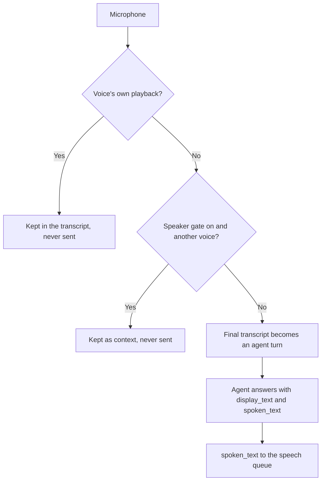

# Voice mode

Run `/voice on` in the chat that should respond to you. Kollab prepares local
voice support in the background, downloads Whisper base (and Parakeet v3 on Apple
silicon), and prepares the selected speech engine (Kokoro by default), warms them, then starts the microphone. Engine setup is automatic. The input box stays usable during setup.

What you say goes straight to the agent: every final transcript becomes a turn in
the responding chat, with no intent or style gate in front of it. Your
words keep the normal conversation queue and permission flow.

The classifier modules, their models and workers stay in Kollab for other
features. Voice does not start or call them, and no voice screen (`/voice`,
the status row, Settings → Voice, the web voice mode) shows classifier
controls, status or decisions.

## In the web UI

The mic in the message box starts voice in the browser, with the browser's
microphone. The agent greets you, hears you through Parakeet, and speaks its
answer sentence by sentence with the selected speech engine (Kokoro or VibeVoice)
while the rest is still being written. Talk over it to stop it: the voice pauses as you start, and once your words come through its turn is cancelled and your words become the next turn. A cough or a short noise only pauses it; after 2 s it carries on.
The strip above the message box shows what voice is doing (Listening, Hearing,
Thinking, Speaking, Interrupted), model downloads and how long each step took
(Hear, Think, Speak, Total). The pulsing mic or the stop button ends it.

The first start sets voice up, and the strip shows each step: it installs voice
support (once, a few minutes), starts the voice service, then loads or downloads
the models. Stop works at any point. The voice service keeps the code of the
Kollab that started it, so after an update voice replaces a service running
other code the next time it starts with no chat using it (`/voice status` shows
which code runs, as Service code). A page that goes away without stopping voice
(a crashed browser, a sleeping laptop, a lost network) has its voice ended
within a minute and a half; turning voice back on within a minute rejoins the
same room.
Web voice also needs
`livekit-server` (`brew install livekit`) and, to install voice support, `uv`
(`brew install uv`); a missing one is named at once. Kollab.app opened from the
Dock finds them on your login shell's PATH, as a terminal does.

This works on a page served from the computer running the agent (Kollab.app,
or the web UI at `127.0.0.1` or `localhost`). On a phone, PhoneLink included,
the mic runs `/voice` on the computer instead; voice from the phone's own
microphone is not available yet.

## In the terminal

Use `/voice status` to inspect setup/download progress, microphone activity,
model warmup, transcription, speech playback and errors. The transcript file uses
UTC timestamps. The compact status row shows a three-bar input level and what voice
is doing (`starting`, `listening`, `hearing`, `transcribing`, `speaking`),
`sending` or `stopped` with how many lines wait, and, when space permits, the
latest transcript. The web UI shows the same line above the message box while
`/voice` is on.

- `/voice` toggles voice for this chat.
- `/voice on` makes this chat the responding conversation.
- `/voice off` releases its microphone lease and cancels unplayed speech.
- `/voice status` shows the service and the code it runs, owner, devices, transcript and queues.
- `/voice retry` retries now. Voice also retries on its own (see Recovery).
- `/voice context` shows the transcript window sent with each request (default 10 lines).
- `/voice context 20` changes it to 20 lines; the allowed range is 1–50.
- `/voice enroll` saves your voiceprint from your next 30 seconds of speech; `/voice
  enroll forget` deletes it. See [Echo cancellation and the speaker gate](#echo-cancellation-and-the-speaker-gate).
- `/voice config` opens Voice Configuration in the TUI or Settings → Voice in the web UI.
  Change the transcript context there, then save for this device.
  Select Whisper Base or Parakeet v3 under Transcription Engine (see
  [Select a transcription engine](#select-a-transcription-engine)), and Kokoro or
  VibeVoice and their voices under Speech Engine. The panel also shows whether voice is
  installed (Voice Setup), microphone, operating state, transcription readiness and speech readiness. Saving does not enable the microphone.
  Preferences are shared across chats on the device running Kollab; an attached
  remote host's web settings apply to that host.
  `/voicemode`, `/vm`, `/voicemodels` and `/vmodels` are no longer registered.


## Flow at a glance



## What is local

One process per OS user owns the microphone, speech models and speaker. It uses
Whisper base on CPU (or Parakeet v3 on an Apple silicon GPU, when selected) and
Kokoro ONNX with `af_heart`. The lightweight agent client
has no audio dependencies. First use installs the pinned audio dependencies into
`~/.kollab/voice/runtimes/`; it does not install them into your agent environment.
Downloads resume and must match the sizes and SHA256 hashes in the bundled
manifest before loading. Verified models work offline.

Data lives in `~/.kollab/voice/`:

- `transcripts/YYYY-MM-DD.jsonl`: timestamped recognized speech, including speech
  the AI ignores. Partial audio and explicit gaps are marked and never dispatched.
- `models/`: verified models.
- `cache/speech/`: audio of voice's own still-working lines so they play without synthesis, one file per line
  and voice, deleted three days after it last played. Agent replies are never
  kept.
- `speech.jsonl`: queued, synthesizing, playing, played, failed or cancelled
  sentence receipts. Played means the audio device completed playback.
- `consumers/`: per-chat cursors and pending records for interrupted delivery.
- `admissions.sqlite3`: durable request identities used to avoid duplicate turns.
- `preferences.json`: device voice settings; never microphone activation.
- `voiceprint.json`: your voiceprint from `/voice enroll`, 192 numbers made by the
  speaker model, never audio. Readable only by you; never synced or sent.
- `logs/service.log`: setup and worker diagnostics.

Raw microphone audio is not saved. Owned, closed daily transcript files expire
after 30 days. Active files and legacy project transcripts are preserved. The
socket and transcript files are restricted to the current OS user.

## When the AI responds

After speech is written to the transcript and capture settles (a pause and no
pending transcription), the complete utterance is sent to the responding agent
as one turn, together with the previous 10 transcript lines by default
(`/voice context`) and any overlapping assistant playback. Prior transcript
lines are context only and cannot be submitted again. The window clears when
capture is restarted and never includes a different microphone owner's session.
The agent answers normally, or returns exactly `.` to stay silent. A response
containing only that period never reaches speech synthesis.

A line that repeats what the assistant itself just spoke (the microphone hears
its own playback) is matched against the overlapping playback text. Echo stays in
the transcript but is never delivered. A reply under three words counts as echo
only when it equals a whole spoken sentence, so "stop" over a reply that says
"stop" still arrives. Talking over voice merges both into one line: runs of three
or more words matching the playback are cut, and only the human's words are sent.

The first voice turn of a session carries the full voice rules (the
`<display_text>`/`<spoken_text>` fields and the silence rules). Later turns
carry only `[voice mode on: the user said this aloud]`. A new voice session, or a
history that compaction emptied of the rules, sends them again.

Assistant responses have separate `display_text` and `spoken_text` fields. The
full answer and code examples stay on screen. Only the spoken field reaches the
device queue; there is no fallback that reads display text. Tool calls, tool
results and private reasoning never become spoken content.

Before playback, a format check rejects code, lists, links and paths. A rejected
spoken reply gets one tool-free nudge to the responding agent to rewrite it. A
missing spoken field is created on that host first, and that counts as the one
rewrite. A reply still rejected after its one rewrite is spoken with code, links,
paths and markup taken out; it is skipped only when nothing speakable is left,
and status shows the reason. Length alone never causes a rewrite. An empty spoken
field or `.` means silence.

Brief updates before tools and final narration use the same sentence queue.
The `voice_out` tool uses that adapter for intentional spoken updates and returns
a nudge when its text is rejected. Repeating an admission does not repeat matching
sentences. Cancellation and ownership changes prevent a late rewrite from playing.

If delivery fails, the transcript remains pending and voice retries on its own.
Speech more than 30 seconds old by the time voice can deliver is kept as context
and is never sent. Once a request is admitted, its progress and final spoken
replies can arrive after that deadline while the same conversation still owns
voice. An ambiguous admission is reconciled with the durable host record rather
than blindly submitted again. Restarting or changing the owner starts at the
current transcript position and does not replay old speech.

Attached chats keep audio on the device running the TUI. Request admission runs
through the attached agent; spoken replies come back to the local speaker queue.
No audio model or microphone starts in the remote agent process. Recognition can
be imperfect; use `/voice off` to close the microphone immediately.

## What voice says itself

While the agent works on a turn it has not answered, voice says a still-working
line ("Still working on it.") after 8 and 25 seconds, unless the agent has spoken
first. Each line's audio is kept in `cache/speech/`, so a line voice has said
before plays at once.

## Echo cancellation and the speaker gate

Two filters sit in front of transcription. Both are off until you turn them on
under Echo and Speaker in `/voice config` (terminal) or Settings → Voice (web).

**Echo Cancellation** removes voice's own speech from the microphone. The speaker
queue records what it plays and when; WebRTC's echo canceller (AEC3) subtracts
it from each microphone frame. Only voice's playback is removed: a TV, other
people and other apps keep their sound. With it on, voice's replies stop showing
up as heard speech. Talking over voice gets harder, though: while voice speaks,
the canceller also turns down your words, so an interruption is heard less
reliably. See the [measurements](../../packages/kollabor-voice/bench/README.md#echo-cancellation).

**Speaker Gate** passes only your voice to the agent. Turn voice on, run
`/voice enroll` and talk for 30 seconds, alone in a quiet room; it prints a
passage you can read. Lines heard while voice speaks, and lines unlike the rest,
are left out of the voiceprint. Nothing you say during enrollment reaches the
agent; the status row counts the seconds. Then turn on Speaker Gate. Each line
of a second or more is compared with your voiceprint; a line below Speaker
Threshold (default 0.45) is marked another speaker. It stays in the transcript
as context for later turns and never reaches the agent. Lines under a
second are not checked and pass. `/voice status` shows both filters.

The speaker model (3D-Speaker ERes2Net, Apache-2.0, 26.5 MB) downloads once,
pinned and checked like the other models, the first time the gate or enrollment
needs it. On recorded speech it rejected 1.6% of a speaker's own lines and let
through 0.5% of other people's and 0.01% of a TV film's
([measurements](../../packages/kollabor-voice/bench/README.md#speaker-gate)).
Raising the threshold keeps out more of the TV and more of you.
`/voice enroll forget` deletes the voiceprint; a new speaker model needs a new
enrollment.

## Recovery

Voice recovers on its own; nothing waits for `/voice retry`:

- When the voice service dies, the connection lease expires, setup fails or
  capture stops with an error, the client starts again after 5 seconds, doubling
  up to 2 minutes. A run that stays healthy for a minute resets the wait. The
  status row shows `starting` until the microphone is live again.
- A failed speech engine (a VibeVoice worker that timed out or exited) is
  prepared again on the next sentence, and on the next start.
- A failed delivery keeps speech pending and retries with a growing wait.
- A voice service call that answers late (models loading, a worker starting) is
  waited for, not treated as a stop.
- Another chat taking the microphone is not a failure: this chat shows Active
  Elsewhere and stays off.

`/voice retry` skips the wait and `/voice off` cancels it.

## Agent integration

The owner can issue an output-only capability with the local `delegate` request.
Pass that capability explicitly to a background producer. It cannot read the
transcript, open the microphone, transfer ownership or extend the owner's lease.

```python
from kollabor_voice.client import VoiceClient

await VoiceClient().voice_out(
    text="The build finished. All checks passed.",
    reply_id="build-42-result",
    owner_epoch=capability["epoch"],
    producer_id=capability["producer_id"],
    token=capability["token"],
)
```

Queue overflow is an explicit rejection. Cancelled synthesis results cannot play
later, and cancelled playback is stopped. Speech interrupted by a service restart
is recorded as cancelled and is never automatically replayed.

Implementation and measured platform/acceptance coverage are recorded in
[`implementation-status.md`](../../specs/voice-mode/implementation-status.md).


## Select a transcription engine

Open `/voice config` (terminal) or Settings → Voice (web), choose Transcription
Engine and save for this device. **Parakeet v3** is the default on Apple silicon,
since voice in the web UI transcribes only with it; **Whisper Base** is the default
elsewhere. Parakeet v3 is NVIDIA's Parakeet TDT 0.6B v3 (CC-BY-4.0, the
`mlx-community` MLX conversion)
running on the GPU through `parakeet-mlx`; it needs an Apple silicon Mac and is
not offered elsewhere. The choice applies without restarting voice.

Selecting Parakeet installs its own pinned runtime into `~/.kollab/voice/runtimes/`
and downloads 2.5 GB of weights once, at a pinned revision checked against the
manifest's SHA-256 before loading. It runs in its own worker process, loaded once.
Whisper stays loaded: it transcribes while Parakeet installs, downloads and warms,
and whenever Parakeet stops; Parakeet is prepared again five minutes after a
failure. Transcription Readiness and `/voice status` show which engine is live and
any download progress or error. The same voice activity detector cuts speech into
utterances for both.

On an M2 Max, Parakeet took a median 69 ms per utterance against Whisper Base's
562 ms, with half the word errors on clean speech and the same share with a
second voice talking
([benchmark](../../packages/kollabor-voice/bench/README.md#speech-to-text-whisper-base-vs-parakeet-v3)).
Differences to know:

- Whisper is told the agent names; Parakeet has no way to be. In the benchmark it
  still wrote aquamarine, lapis and zircon right, but never "Kollab" ("Column",
  "Colab", "Colib").
- On a Mac short of memory the first utterance after a pause can stall while
  macOS brings the idle worker back: one run saw 14–113 s. A line that takes over
  30 s is transcribed by Whisper instead, and Parakeet is prepared again five
  minutes later.
- Parakeet transcribes 25 European languages but does not report which one, so
  its text is treated as English. Whisper's non-English speech goes to the agent as heard.

## Select a speech engine

Open `/voice config` (terminal) or Settings → Voice (web). Choose `vibevoice`
under Speech Engine and save for this device. This prepares an isolated runtime
from a pinned Microsoft VibeVoice source archive, verifies the selected voice
preset by hash, and warms the model without opening the microphone. Read Speech
Readiness or `/voice status`. A setup error retries on its own; `/voice retry`
retries now.

VibeVoice uses Microsoft VibeVoice-Realtime-0.5B. Presets are Carter, Davis, Emma,
Frank, Grace, Mike and Samuel. A trusted cached `.pt` file in Custom VibeVoice
Prompt overrides the preset. Model accepts the default Microsoft model name or
an existing absolute model directory; an installed model in the usual local
VibeVoice directory is detected. Auto device chooses MPS, then CUDA, then CPU.
Diffusion Steps (1–20) and Guidance (1.0–3.0) control generation.

Kokoro remains selectable with its English voice presets and Speed (0.5–2.0).
Inactive engine settings are retained. A change applies at the next sentence;
failed VibeVoice inference is shown as an error and never silently becomes
Kokoro. Both engines return waveform samples to the same serialized speaker
queue. Cancellation and ownership changes still suppress late synthesis. The
VibeVoice worker never plays audio itself or changes the Codex speech hook.

Dependencies, voice presets and default weights download on first use and are
cached. Heavy libraries stay out of the main Kollab process. Custom model
directories and custom voice prompts are user-owned files and are preserved.

## Voice Prompt settings

Settings → Voice → Voice Prompt in the web UI, or `/voice config` in the terminal, holds three settings. They change
spoken replies only; typed messages never see them.

- **Instructions**: text added to the instructions of every spoken reply, up to 32 KiB. Clear it to go back to the
  default: "You are speaking out loud. Answer in short natural sentences, no markdown, no lists, no code blocks. Say
  what you did, not how you did it." It is saved as `~/.kollab/prompt-overrides/voice/default.md`, the file the
  engine's `PUT /voice/settings/prompt` writes.
- **Personality**: Max Gen Z (the default), Neutral or Professional. Saved as `voice.livekit.personality` in
  `~/.kollab/config.json`.
- **Reasoning**: Off (the default, and the fastest) or Low. Saved as `voice.livekit.reasoning` in
  `~/.kollab/config.json`. Typed messages keep the chat's own effort.

These settings are the default voice prompt: every agent without a voice prompt of its own speaks
with them. An agent given its own voice prompt through the engine API keeps it. In
the terminal, Instructions is a one-line field; a line break typed in the web UI shows there as ⏎.
