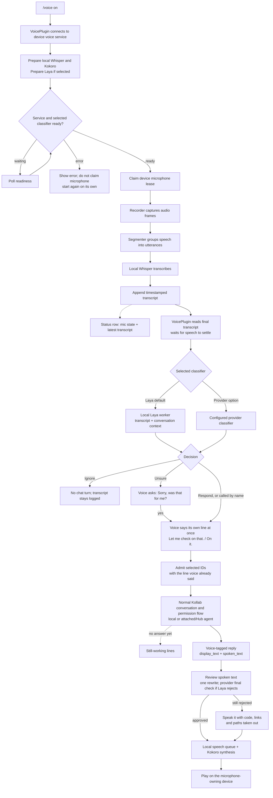
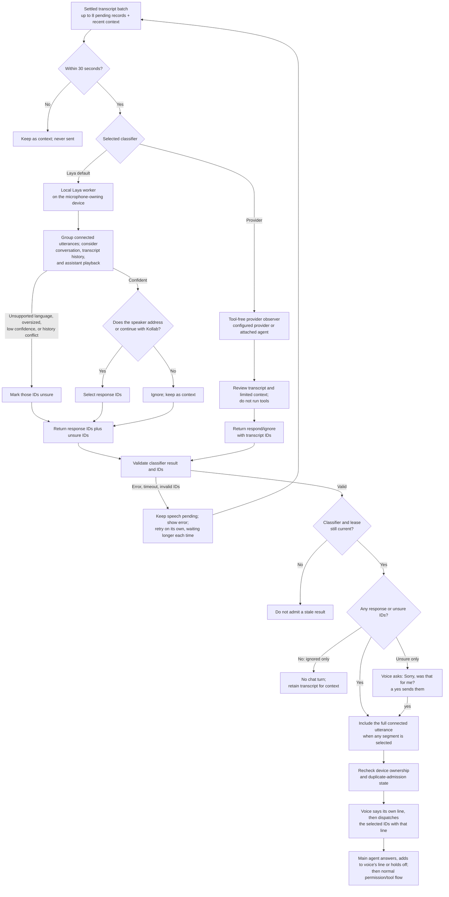

# Voice mode

Run `/voice on` in the chat that should respond to you. Kollab prepares local
voice support in the background, downloads Whisper base and the default Laya classifier, and prepares the selected
speech engine (Kokoro by default), warms them, then starts the microphone. Engine setup is automatic. The input box stays usable during setup.

Use `/voice status` to inspect setup/download progress, microphone activity,
model warmup, transcription, speech playback and errors. The transcript file uses
UTC timestamps. The compact status row shows a three-bar input level and what voice
is doing (`starting`, `listening`, `hearing`, `transcribing`, `deciding`, `asking`,
`speaking`), what the classifier did with your last words (`laya sent`, `ignored`,
`unsure`, `deciding` or `stopped`, then how many lines wait), voice's own last line
for ten seconds (`said: Let me check on that.`) and, when space permits, the latest
transcript. The web UI shows the same line above the message box.

- `/voice` toggles voice for this chat.
- `/voice on` makes this chat the responding conversation.
- `/voice off` releases its microphone lease and cancels unplayed speech.
- `/voice status` shows the service, owner, devices, transcript and queues.
- `/voice retry` retries now. Voice also retries on its own (see Recovery).
- `/voice classifier` opens the decision log: each classifier call on the left;
  on the right what was heard, what the classifier read (transcript history, recent
  conversation, the agent's own speech), each pass's answer, the decision, and what
  reached the agent. Lines dropped as the agent's own voice show as `echo`. It
  updates while open. Without a terminal it names the classifier and both choices.
- `/voice classifier laya` selects the default local classifier.
- `/voice classifier provider` selects the active AI provider instead.
- `/voice context` shows the recent transcript window (default 10 lines).
- `/voice context 20` changes it to 20 lines; the allowed range is 1–50.
- `/voice config` opens Voice Configuration in the TUI or Settings → Voice in the web UI.
  Change the classifier and transcript context there, then save for this device.
  Select Kokoro or VibeVoice and configure their voices there. The panel also shows
  microphone, transcription engine, operating state and speech readiness. Saving does not enable the microphone.
  Preferences are shared across chats on the device running Kollab; an attached
  remote host's web settings apply to that host.
  `/voicemode`, `/vm`, `/voicemodels` and `/vmodels` are no longer registered.

## Flow at a glance



## Intent decision detail

The classifier selects which transcript IDs should wake the responding agent; it
does not draft the answer. Provider classification is respond/ignore. Laya can
also defer uncertain or unsupported speech to the main agent.



Voice activates only through an explicit command. Starting another agent or
inheriting an old enabled setting never starts its microphone. The latest
explicit activation owns responses. An older chat shows Active Elsewhere.
Closing the owning chat stops capture when its three-second lease expires.
The shared service can remain idle with its models loaded. Classifier selection is
saved for this device; changing it preserves pending speech and does not enable
the microphone by itself.

## What is local

One process per OS user owns the microphone, speech models and speaker. It uses
Whisper base on CPU and Kokoro ONNX with `af_heart`. The lightweight agent client
has no audio dependencies. First use installs the pinned audio dependencies into
`~/.kollab/voice/runtimes/`; it does not install them into your agent environment.
Downloads resume and must match the sizes and SHA256 hashes in the bundled
manifest before loading. Verified models work offline. Laya runs in one persistent
Python worker owned by the device service, with its own pinned environment and
verified `typed-decisions` checkpoint. Multiple agents share the same worker;
changing the responding conversation does not reload idle model weights. Laya
uses a bundled voice intent head over its frozen checkpoint. The current
[local evaluation](../../packages/kollabor-voice/bench/README.md) records its
remaining classification errors and the decisions it is unsure about; it is not a guarantee that all
background speech will be recognized correctly.

Data lives in `~/.kollab/voice/`:

- `transcripts/YYYY-MM-DD.jsonl`: timestamped recognized speech, including speech
  the AI ignores. Partial audio and explicit gaps are marked and never dispatched.
- `models/`: verified default models.
- `cache/speech/`: audio of voice's own lines (acknowledgements, "was that for
  me?", still-working lines) so they play without synthesis, one file per line
  and voice, deleted three days after it last played. Agent replies are never
  kept.
- `speech.jsonl`: queued, synthesizing, playing, played, failed or cancelled
  sentence receipts. Played means the audio device completed playback.
- `consumers/`: per-chat cursors and pending records for interrupted delivery.
- `admissions.sqlite3`: durable request identities used to avoid duplicate turns.
- `preferences.json`: selected classifier; never microphone activation.
- `logs/service.log` and `logs/laya.log`: setup and worker diagnostics.

Raw microphone audio is not saved. Owned, closed daily transcript files expire
after 30 days. Active files and legacy project transcripts are preserved. The
socket and transcript files are restricted to the current OS user.

## When the AI responds

After speech is written to the transcript, Laya decides locally whether it is
addressed to the assistant. A voice-specific decision contract includes the full
utterance, the previous 10 complete transcript lines by default, the last six
visible conversation messages (three exchanges, 200 characters each) and any
overlapping assistant playback. When that runs over Laya's context, the oldest
conversation text is dropped first. Prior
transcript lines include ignored speech and already admitted requests. They are
context only and cannot be submitted again. The window clears when capture is
restarted and never includes a different microphone owner's session.

Laya judges the utterance twice when history is present: once with the history
and once on its own. A pass at or above the confidence threshold (0.8) decides,
so history alone cannot push a clear request into doubt. When neither pass is
sure, or the sure passes disagree, voice asks "was that for me?" (see What voice
says itself). This prevents a background-TV notice from acting as a blanket mute
on a clear new request. Confident background speech is ignored. Uncertain,
unsupported-language or oversized utterances are asked about the same way. They
do not block later speech. The main agent responds normally when addressed, or
returns exactly `.` to stay silent. A response containing only that period never
reaches speech synthesis.

Before classification, a line that repeats what the assistant itself just spoke
(the microphone hears its own playback) is matched against the overlapping
playback text. Echo stays in the transcript but is never classified or
delivered. A reply under three words counts as echo only when it equals a whole
spoken sentence, so "stop" over a reply that says "stop" still arrives. Talking
over voice merges both into one line ("Bear with me still looking into- Hello,
can you hear me?"): runs of three or more words matching the playback are cut,
and only the human's words are judged and sent.

The first voice turn of a session carries the full voice rules (the
`<display_text>`/`<spoken_text>` fields and the silence rules). Later turns
carry only `[voice mode on: the user said this aloud]`, plus `[you already
said: ...]` with voice's own line. A new voice session, or a history that
compaction emptied of the rules, sends them again.
Invalid results or provider failures pause admission with a visible error and
retry on their own; there is no automatic switch to another provider.
`/voice status` names the selected classifier and reports actual setup/readiness.

Choosing `provider` uses a separate tool-free request through the active chat's
AI profile. That option sends transcript text and limited recent conversation
context, including the recent transcript window, to the configured provider and
can incur inference charges. Accepted
speech, and speech confirmed after "was that for me?", still goes to the main
agent under either classifier option. Local classification does not make a
hosted main agent local. Once listening, an
unavailable classifier or agent does not stop durable transcription.

Connected speech segments are kept together, including a lead-in initially
classified as background speech. The observer waits for a pause and pending
transcription before admitting a request; selecting its question includes the
rest of that connected utterance.

Accepted requests enter the normal conversation queue and permission flow.
Assistant responses have separate `display_text` and `spoken_text` fields. The
full answer and code examples stay on screen. Only the spoken field reaches the
speech classifier and device queue; there is no fallback that reads display text.
Tool calls, tool results and private reasoning never become spoken content.

Before playback, the selected classifier checks that narration reads as natural
speech. One or two short sentences are preferred, but length alone is never a
reason to rewrite: a longer reply is still spoken. Laya uses a separate style
head over the same loaded encoder. If Laya is unsure, the agent's configured
provider performs a tool-free style check of only the spoken text. Format limits
still reject code, lists, links and paths. A rejected spoken reply gets one
tool-free nudge to the responding agent to rewrite it, then is checked again. If
Laya rejects that rewrite despite valid formatting, the configured provider
makes one final style decision. A missing spoken field is created on that host
first, and that counts as the one rewrite. A reply still rejected after its one
rewrite is spoken with code, links, paths and markup taken out; it is skipped
only when nothing speakable is left, and status shows the reason. The written
answer stays on screen. The next reply is processed automatically and clears the
earlier error when its review starts. An empty spoken field or `.` means
silence.

Brief updates before tools and final narration use the same sentence queue.
The `voice_out` tool uses that adapter for intentional spoken updates and returns
a nudge when its text is rejected. Repeating an admission does not repeat matching
sentences. Cancellation and ownership changes prevent a late rewrite from playing.

Echo the playback match misses still reaches the classifier with the overlapping
playback text as context. Overlapping speech remains in the transcript. This is
not acoustic echo cancellation. Recognition and response decisions can be
imperfect; use `/voice off` to close the microphone immediately.

If inference fails, the transcript remains pending instead of becoming an
automatic command, and voice retries on its own. Speech more than 30 seconds old
by the time voice can decide is kept as context for what comes next and is never
sent. Once a request is admitted, its progress and final spoken replies can
arrive after that deadline while the same conversation still owns voice.
An ambiguous admission is reconciled with the durable host record rather than
blindly submitted again. Restarting or changing the owner starts at the current
transcript position and does not replay old speech.

Attached chats keep audio on the device running the TUI. Transcript observation
uses the local Laya worker by default, or the attached agent for the provider
option. Request admission runs through the attached agent; spoken replies come back
to the local speaker queue. No audio model or microphone starts in the remote
agent process.

## What voice says itself

Voice speaks before the agent does, so speech never meets silence:

- **Speech for the agent:** a short acknowledgement ("Let me check on that.",
  "On it.") at once, sent with the words as `[you already said: ...]`, so the
  agent answers from there instead of repeating it.
- **A mic check, thanks or a bare name:** voice answers itself ("Yes, I can hear
  you.", "You're welcome.", "Hi, I'm listening.") and still sends the words to the
  agent with that answer. The agent may add more, or hold off with `.`. After a
  bare name, the next 15 seconds of speech go to the agent too.
- **Unsure speech:** "Sorry, was that for me?" A yes sends the held words. A no
  ("no, it's the TV") stops these questions for two minutes. No answer within 12
  seconds after voice stops talking stops them for 30 seconds. Calling the agent
  by name always gets through, and unsure thanks are not asked about.
- **While the agent works:** still-working lines ("Still working on it.") after 8
  and 25 seconds, unless the agent has spoken or voice already answered the turn
  itself.

Each line is said once per batch of words, even when admission is retried. Its
audio is kept in `cache/speech/`, so a line voice has said before plays at once.

## Recovery

Voice recovers on its own; nothing waits for `/voice retry`:

- When the voice service dies, the connection lease expires, setup fails or
  capture stops with an error, the client starts again after 5 seconds, doubling
  up to 2 minutes. A run that stays healthy for a minute resets the wait. The
  status row shows `starting` until the microphone is live again.
- A failed speech engine (a VibeVoice worker that timed out or exited) is
  prepared again on the next sentence, and on the next start.
- A failed or timed-out classifier keeps speech pending and retries with the
  same growing wait; a failed Laya worker is prepared again.
- A voice service call that answers late (models loading, a worker starting) is
  waited for, not treated as a stop.
- Another chat taking the microphone is not a failure: this chat shows Active
  Elsewhere and stays off.

`/voice retry` skips the wait and `/voice off` cancels it.

## Agent integration

The owner can issue an output-only capability with the local `delegate` request.
Pass that capability explicitly to a background producer. It cannot read the
transcript, open the microphone, transfer ownership or extend the owner's lease.

```python
from kollabor_voice.client import VoiceClient

await VoiceClient().voice_out(
    text="The build finished. All checks passed.",
    reply_id="build-42-result",
    owner_epoch=capability["epoch"],
    producer_id=capability["producer_id"],
    token=capability["token"],
)
```

Queue overflow is an explicit rejection. Cancelled synthesis results cannot play
later, and cancelled playback is stopped. Speech interrupted by a service restart
is recorded as cancelled and is never automatically replayed.

Implementation and measured platform/acceptance coverage are recorded in
[`implementation-status.md`](../../specs/voice-mode/implementation-status.md).


## Select a speech engine

Open `/voice config` (terminal) or Settings → Voice (web). Choose `vibevoice`
under Speech Engine and save for this device. This prepares an isolated runtime
from a pinned Microsoft VibeVoice source archive, verifies the selected voice
preset by hash, and warms the model without opening the microphone. Read Speech
Readiness or `/voice status`. A setup error retries on its own; `/voice retry`
retries now.

VibeVoice uses Microsoft VibeVoice-Realtime-0.5B. Presets are Carter, Davis, Emma,
Frank, Grace, Mike and Samuel. A trusted cached `.pt` file in Custom VibeVoice
Prompt overrides the preset. Model accepts the default Microsoft model name or
an existing absolute model directory; an installed model in the usual local
VibeVoice directory is detected. Auto device chooses MPS, then CUDA, then CPU.
Diffusion Steps (1–20) and Guidance (1.0–3.0) control generation.

Kokoro remains selectable with its English voice presets and Speed (0.5–2.0).
Inactive engine settings are retained. A change applies at the next sentence;
failed VibeVoice inference is shown as an error and never silently becomes
Kokoro. Both engines return waveform samples to the same serialized speaker
queue. Cancellation and ownership changes still suppress late synthesis. The
VibeVoice worker never plays audio itself or changes the Codex speech hook.

Dependencies, voice presets and default weights download on first use and are
cached. Heavy libraries stay out of the main Kollab process. Custom model
directories and custom voice prompts are user-owned files and are preserved.
