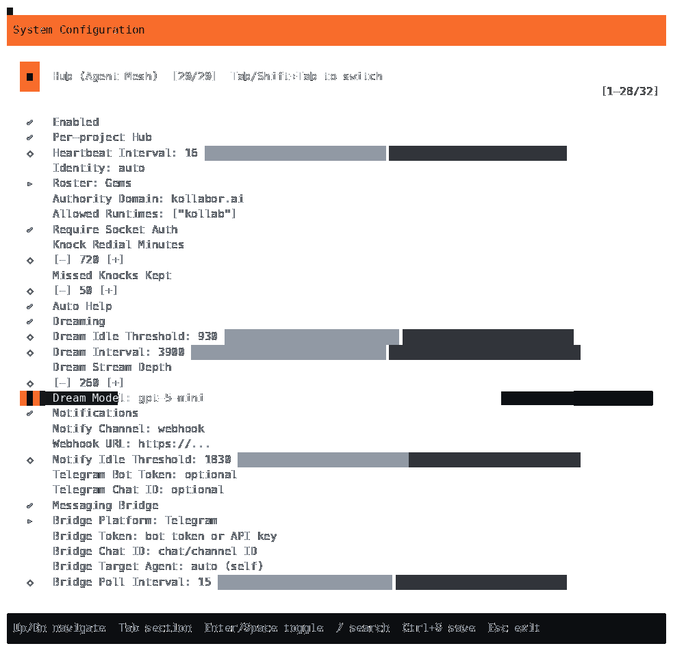

# Issue #260 `/config` Dream Model terminal evidence

Captured from code at source SHA `711e3638cbb9c74d49d92c0eb6acd3cae295da3c`.

This is an isolated render of the actual `ConfigAltView` `/config` screen and
`Hub (Agent Mesh)` Dream Model widget through `FullScreenRenderer` in a 100x42
PTY. The script navigates the real view using its Tab and ArrowDown handlers and
asserts that `Dream Model` is focused before rendering.



The display uses the real TUI component and renderer, not a fabricated terminal
mock. It is component-render evidence only, not live application startup or
provider qualification. `render_config.py` supplies an in-memory config whose
Dream Model value is the synthetic `gpt-5-mini`; other widget values are defaults.
The script sets temporary HOME, KOLLAB_HOME, XDG_CONFIG_HOME, and working
directory, patches managed-state reading to return no data, and removes provider
API-key and engine-URL environment variables. It does not read or persist the
user's config, launch the application or engine, call a provider, or make network
requests.

## Reproduce

Run from the repository root at the source SHA above. Requires the workspace
dev dependencies, `asciinema`, `agg`, and ImageMagick `magick`.

```sh
asciinema rec --quiet --cols 100 --rows 42 \
  --command 'uv run --all-packages --group dev python docs/verification/issue-260/render_config.py --theme dark' \
  /tmp/kollab-270-config-dark.cast
agg --cols 100 --rows 42 --theme asciinema --last-frame-duration 3 \
  /tmp/kollab-270-config-dark.cast /tmp/kollab-270-config-dark.gif
magick '/tmp/kollab-270-config-dark.gif[1]' \
  docs/verification/issue-260/dream-model-dark.png
```

The attached PNG is the final frame of the recorded PTY output (983x963). The
asciicast records the full interactive render and can be used to regenerate it.
Only dark theme evidence is attached: this TUI exposes dark, ocean, and mono
choices, not a light theme. Phone, tablet, and desktop browser viewport evidence
is not applicable to this terminal-only setting surface.
