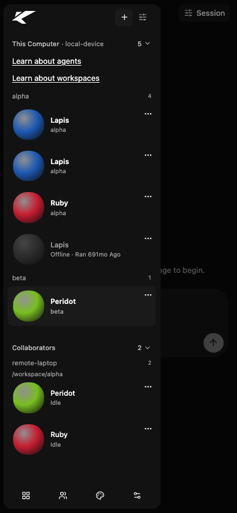
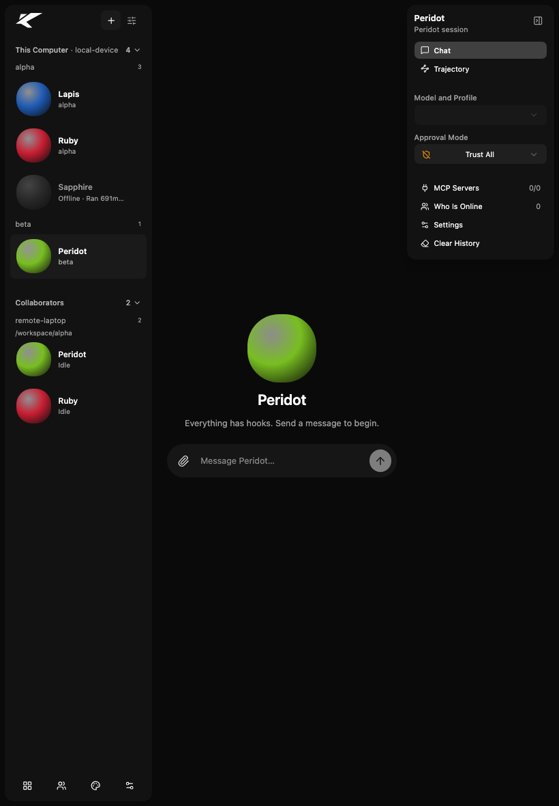
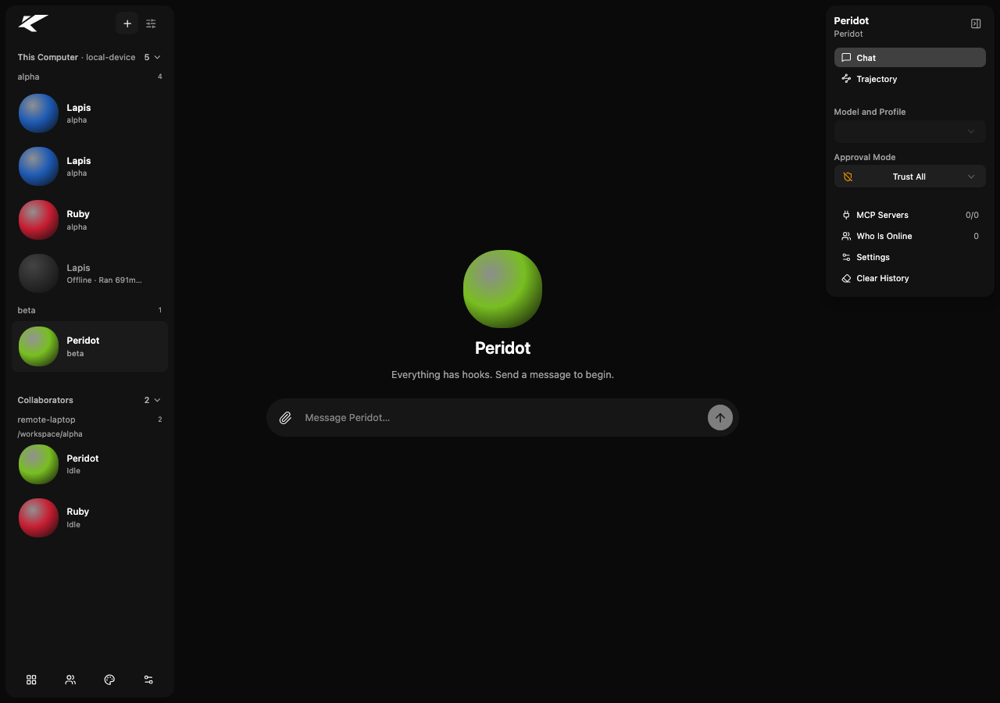
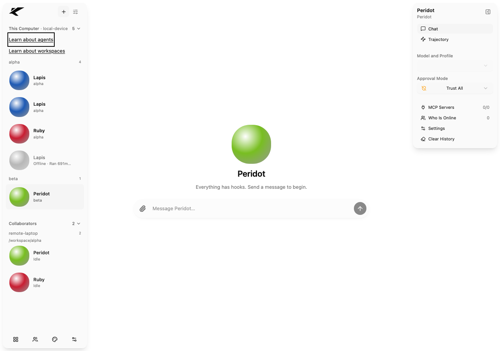
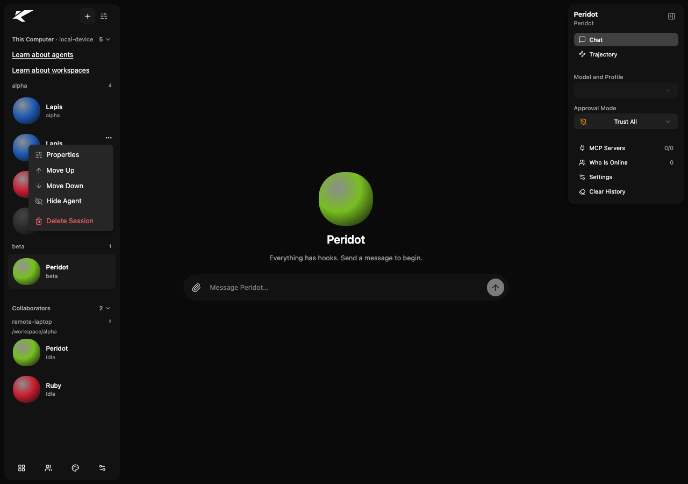

# Issue #263 browser verification

Captured from source commit `6989e735` on branch `issue-263-agent-list-order` with
headless Google Chrome and the worktree-local Vite build.

The sidebar API was intentionally mocked. Chrome blocked requests to the live
engine (`127.0.0.1:7433`, including WebSocket) and API proxy (`127.0.0.1:8080`);
the mock supplied repeated local sessions for one identity/workspace, an offline
overlap, a second workspace, and a remote network/device/workspace. It recorded
the order POST. No live engine or real agent was contacted.

Responsive checks used the following viewports. At 390 x 844, the sidebar was
opened with Toggle Sidebar; it was open by default at 820 x 1180 and 1280 x 900.
Document/body width matched each viewport, and workspace groups, remote
device/workspace rows, and both Learn links were visible.

390 x 844 phone viewport:

820 x 1180 tablet viewport:

1280 x 900 desktop viewport:

Keyboard focus in the light theme at 1280 x 900:

The second live Lapis session row exposes Move Up and Move Down independently
from other same-identity rows. Move Down sent unique session keys plus the
persona/offline fallback anchor to the mock API:

Accessibility and layout checks on the rendered Learn links:

- Link text contrast measured 17.95:1 in dark mode and 18.97:1 in light mode.
- The 2 px foreground focus outline measured 17.95:1 in dark mode and 18.97:1
  in light mode. Keyboard Tab reached both Learn links with `:focus-visible`.
- Link text rendered at 12.6 px and each target measured 29 px high.
- No horizontal overflow at the three viewport sizes; initial layout shift was
  0.000014 and no JavaScript/console errors were observed.

Combined Learn route verification used a temporary tree pinned to Learn PR #278
at `f47f3de376c4a11195ffa504306889183fc51889`. Only the two exact anchor blocks
from #272 commit `65cb9f23` were applied to that temporary copy; this was a route
integration check, not a branch merge. Agents opened `/learn?topic=agents` and
Workspaces opened `/learn?topic=workspaces`, rendering the corresponding lesson
headings. The `learnHref`/`readLearnRoute` contract tests passed 2/2, and the
combined frontend typecheck/build passed. No files were changed on PR #278.
Its current topic content does not yet describe the new Move Up/Move Down
ordering control; that Learn-content item remains open.

This is responsive UI, menu, and combined-route evidence only, not a live
browser-to-engine end-to-end run. Engine persistence and stale-client behavior
are covered separately by `packages/kollabor-engine/tests/test_sidebar_order.py`,
including a fresh OS process reading saved order through `GET /sessions`.
