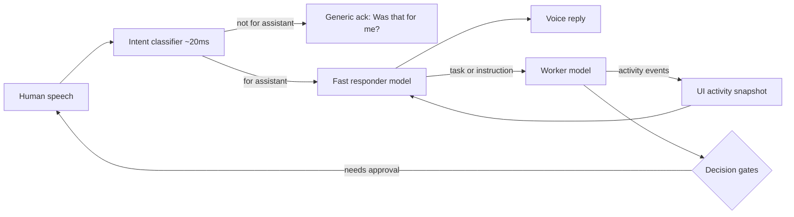

# Kollab Voice Mode Architecture (Spec)

Status: Draft spec only. Nothing here is built yet.
Author: Marco (dictated), written up by Marclone.

## Goal

Voice conversations with Kollab should feel instant. Today the voice model says "hold on" while it researches before answering. This spec splits voice mode into layers so the human always gets a fast reply while the real work continues in the background.

## Overview



## 1. Intent classifier layer

- Runs on every finished utterance with a target latency of about 20 ms.
- Decides one thing: is this utterance addressed to the assistant?
- If it is, it passes the utterance to the fast responder.
- If it is not, or the classifier is not confident, it gives a short generic acknowledgment like "Hey, was that for me?" or "One sec." Otherwise it stays silent, depending on the config.
- The classifier must be tiny: a local small model or a heuristic plus a small model. No network round trip in the hot path if possible.
- Open questions: wake-word fallback, confidence thresholds, and how to handle multiple speakers in the room.

## 2. Fast responder model

- A separate fast, cheap model instance (for example Haiku or a similar small model). Its only job is to talk to the human quickly in voice mode.
- Right before each reply, it gets a snapshot of the UI activity view. That is the same summarized view the human sees (for example "ran git status", "editing src/foo.py", "tests passing"). It does NOT get full file reads, raw command text, or tool output.
- It can:
  - answer from conversation context and the activity snapshot,
  - say what the worker is doing right now,
  - turn spoken instructions into tasks for the worker,
  - ask clarifying questions.
- It cannot run tools, edit files, or take gated actions. Anything substantive goes to the worker.
- Latency budget: first audio within roughly 1 second of the utterance ending.

## 3. Worker model

- The worker is whatever model the human is currently working with in that session (the configured agent model).
- It keeps doing the real research, edits, and commands in the background, and is never blocked by the voice conversation.
- It emits activity events that feed the UI activity view, which is the fast responder's snapshot source.
- Results that matter (done, blocked, a question for the human) get pushed to the fast responder so it can say them out loud.

## 4. Decision gates stay intact

- Neither the fast responder nor the worker may skip human approval for gated actions: merges, release tags, pushes to protected branches, restarts, deletions, sends, and anything else the gate policy covers.
- When the fast responder hears approval in voice, it records it as an explicit approval event tied to the specific pending gate. It never treats it as a general permission.
- If the approval is ambiguous, it asks again. A "yeah" with no clear gate is not approval.
- Gates are enforced in the engine, not in the prompts, so a model mistake cannot bypass them.

## 5. Dreaming on a fast, cheap model

- When an agent is idle, it enters a dreaming state. It reviews its recent conversations and builds or refreshes user profiles and crystallized memories.
- That background work runs on a designated fast, cheap model, not the worker model, to save cost and tokens.
- Dreaming must be interruptible. It stops right away when new work or voice input arrives.
- Its output is written to the memory store and can be reviewed. It does not change code or take gated actions.

## Configuration (proposed)

```yaml
voice:
  classifier: local-small        # ~20ms target
  responder_model: haiku         # fast and cheap
  ack_phrases: ["Hey, was that for me?", "One sec."]
dreaming:
  model: haiku                   # fast and cheap
  idle_after_seconds: 300
```

## Out of scope for this spec

- The implementation, the choice of speech-to-text and text-to-speech providers, and UI design details. These will be follow-up issues once this spec is approved.
