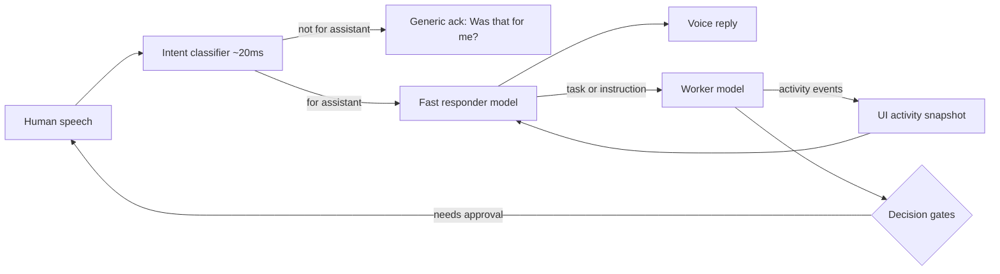

# Kollab Voice Mode Architecture (Spec)

Status: Historical draft. Superseded by issue 301: the intent classifier is no longer part of voice and every final transcript goes straight to the agent turn (see features/voice-mode.md). The classifier modules stay for other features.
Author: Marco (dictated), written up by his supervising agent session.

## Goal

Voice conversations with Kollab should feel instant. Today the voice model says "hold on" while it researches before answering. This spec splits voice mode into layers so the human always gets a fast reply while the real work continues in the background.

## Overview



## 1. Intent classifier layer

- Runs on every finished utterance with a target latency of about 20 ms.
- Decides one thing: is this utterance addressed to the assistant?
- If it is, it passes the utterance to the fast responder.
- If it is not, or the classifier is not confident, it gives a short generic acknowledgment like "Hey, was that for me?" or "One sec." Otherwise it stays silent, depending on the config.
- The classifier must be tiny: a local small model or a heuristic plus a small model. No network round trip in the hot path if possible.
- Open questions: wake-word fallback, confidence thresholds, and how to handle multiple speakers in the room.

## 2. Fast responder model

**Built (#388):** words said while a turn runs get an answer from the Quick Model
(`kollabor/llm/voice_aside.py`), on a provider of its own, within 2.5 s. Its snapshot
is each tool's name and state from the display tap (`kollabor_voice.responder`), never
a command or a path. It replies `ANSWER` (the voice turn's whole reply) or `FORWARD`
(one line now, then the words queue for their own turn). No Quick Model, a timeout or
a reply that does not parse says the newest tool's state and queues the words. One
call runs at a time, ten in five minutes. An open ask wins: a yes or no goes to it.

**Built (#388, part 2):** the worker reads each turn's stream in a task of its own
(`TurnReader` in `kollabor_voice/livekit_worker.py`). A reply quiet for `HAND_BACK_S`
(3 s) hands the floor back: LiveKit has no speech to interrupt, so words said then are
a new voice turn and reach the aside, and the turn's later sentences are announced
(`session.say`) once nobody speaks. Talking over the agent's voice, a reply or an
announcement, still stops its turn: the stream closes and the Engine reads that as a
talk-over. A spoken stop needs no model (`responder.is_stop`: "stop", "cancel that",
"abort"), and the Quick Model can say `STOP` too ("never mind" is its call). Either stops the running turn
as ESC does; the Engine marks the line (`"stop": true`) and the worker stops every
turn still running there. The words of a stop are not queued.

- A separate fast, cheap model instance (for example Haiku or a similar small model). Its only job is to talk to the human quickly in voice mode.
- Right before each reply, it gets a snapshot of the UI activity view. That is the same summarized view the human sees (for example "ran git status", "editing src/foo.py", "tests passing"). It does NOT get full file reads, raw command text, or tool output.
- It can:
  - answer from conversation context and the activity snapshot,
  - say what the worker is doing right now,
  - turn spoken instructions into tasks for the worker,
  - ask clarifying questions.
- It cannot run tools, edit files, or take gated actions. Anything substantive goes to the worker.
- Latency budget: first audio within roughly 1 second of the utterance ending.

## 2a. Handoff queue

Status: design only, not built. Today only the responder's model key and activity snapshot exist (`packages/kollabor-voice/src/kollabor_voice/responder.py`); there is no queue code.

- Every utterance the fast responder cannot answer from the conversation and the activity snapshot becomes one queue item. The item carries the user's exact words, a generated id, and a timestamp. Nothing is paraphrased on the way in.
- Results travel back on the same queue as separate items that name the id of the question they answer. The fast responder matches results to questions by id, never by position or wording, and reads each aloud when it arrives. The speaker never waits on research.
- Ordering: items are delivered to the worker oldest first. A result may arrive out of order; it is still matched by id and spoken as "about your question on X" when other items were answered in between.
- Dedup: an item whose normalized text matches a still-open item (same words after trimming case and filler) is attached to that item as a repeat instead of becoming a second task. A repeat of an answered question is a new item.
- Worker busy mid-turn: the worker is never interrupted by the queue. Pending items are collected and handed over with the worker's next model-visible turn, the same way other non-human context already reaches it (see 2b). While an item waits, the responder can say it is queued and what the worker is doing now, from the activity snapshot.
- A cancelled or abandoned item is closed with a short result so the responder never waits on it forever.
- Decision gates are unchanged: a queue item that asks for a gated action is only a request. The worker still raises the gate and Marco still approves it (section 4).

## 2b. Hidden worker nudge

Status: design only, not built. The delivery mechanism below exists; the voice nudge text, template and settings do not.

- When voice mode is on, the worker gets a short nudge saying this is speaker-enabled voice mode, shows the conversation so far, and tells it to provide the information to the speaker through the queue results in 2a.
- Hidden from the UI by the convention Kollab already uses for non-displayed runtime context: `LLMCoordinator.inject_system_message(content, subtype=...)` (`kollabor/llm/llm_coordinator.py:164`) queues an agent HUD entry (`queue_agent_hud`, `llm_coordinator.py:1740`) that is merged into the next real turn as an `<agent_hud>` block (`kollabor/llm/agent_hud.py:71-96`). It never creates its own turn. The web UI strips that block before display (`stripAgentHud`, `packages/kollabor-webui/frontend/src/api.ts:172`; parsed in `hub-notes.ts:155`). Existing callers use the same call with their own subtype, for example `crystal_nudge` (`plugins/hub/plugin.py:9707`) and `goal_context` (`kollabor/goals/driver.py:249`). The voice nudge would use subtype `voice_mode`.
- Parameterized template. Proposed parameters: `{conversation}` (the last N exchanges, oldest first), `{window}` (N), `{pending}` (open queue item ids and their exact words). Proposed default wording:

  > Voice mode is on and a speaker is listening. Conversation so far: {conversation}. Open spoken questions: {pending}. Provide the information the speaker asked for as results on the voice queue, short enough to say aloud. Gated actions still need explicit approval.

- Settings keys, under the existing `kollabor.voice.*` namespace (`kollabor.voice.responder_model` already exists): `kollabor.voice.nudge_enabled`, `kollabor.voice.nudge_window` (default 10 exchanges), `kollabor.voice.nudge_template` (text above as the default). Each needs a default and a `/config` widget entry when built, so wording or window size can be fixed without a code change.
- The nudge only supplies context. It grants no permission and cannot disable a gate; gates stay enforced in the engine (section 4).

## 3. Worker model

- The worker is whatever model the human is currently working with in that session (the configured agent model).
- It keeps doing the real research, edits, and commands in the background, and is never blocked by the voice conversation.
- It emits activity events that feed the UI activity view, which is the fast responder's snapshot source.
- Results that matter (done, blocked, a question for the human) get pushed to the fast responder so it can say them out loud.

## 4. Decision gates stay intact

- Neither the fast responder nor the worker may skip human approval for gated actions: merges, release tags, pushes to protected branches, restarts, deletions, sends, and anything else the gate policy covers.
- When the fast responder hears approval in voice, it records it as an explicit approval event tied to the specific pending gate. It never treats it as a general permission.
- If the approval is ambiguous, it asks again. A "yeah" with no clear gate is not approval.
- Gates are enforced in the engine, not in the prompts, so a model mistake cannot bypass them.

## 5. Dreaming on a fast, cheap model

- When an agent is idle, it enters a dreaming state. It reviews its recent conversations and builds or refreshes user profiles and crystallized memories.
- That background work runs on a designated fast, cheap model, not the worker model, to save cost and tokens.
- Dreaming must be interruptible. It stops right away when new work or voice input arrives.
- Its output is written to the memory store and can be reviewed. It does not change code or take gated actions.

## Configuration (proposed)

```yaml
voice:
  classifier: local-small        # ~20ms target
  responder_model: haiku         # fast and cheap
  ack_phrases: ["Hey, was that for me?", "One sec."]
dreaming:
  model: haiku                   # fast and cheap
  idle_after_seconds: 300
```

## Out of scope for this spec

- The implementation, the choice of speech-to-text and text-to-speech providers, and UI design details. These will be follow-up issues once this spec is approved.
